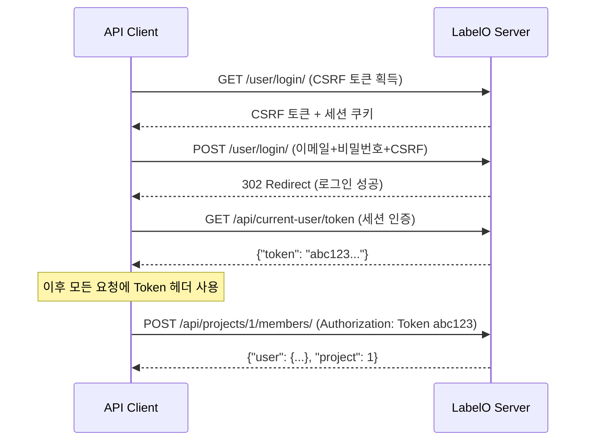

# LabelO 외부 API 클라이언트 프로그램 - Walkthrough

## 개요

LabelO 솔루션의 REST API를 외부에서 호출하여 **ID/PW로 인증 → 토큰 획득 → 프로젝트에 라벨러 등록**을 수행하는 Python 프로그램을 작성했습니다.

## 생성된 파일

### 1. [labelo_api_client.py](file:///D:/_Dev/labelo_/labelo_api_client.py) (메인 프로그램)

**`LabeloAPIClient` 클래스** — 모든 API 호출을 래핑한 클라이언트:

| 메서드 | 설명 |
|--------|------|
| `login(email, password)` | 세션 로그인 → CSRF 토큰 → API 토큰 획득 |
| `login_with_token(token)` | 기존 토큰으로 직접 인증 |
| `get_whoami()` | 현재 인증된 사용자 정보 반환 |
| `list_projects()` | 프로젝트 목록 조회 |
| `get_project(id)` | 프로젝트 상세 조회 |
| `list_users()` | 조직 내 사용자 목록 |
| `get_project_members(id)` | 프로젝트 멤버(라벨러) 목록 |
| `get_available_users(id)` | 추가 가능한 사용자 목록 |
| `add_labeler(project_id, user_id)` | 라벨러 등록 |
| `remove_labeler(project_id, user_id)` | 라벨러 제거 |
| `add_labelers_bulk(project_id, user_ids)` | 라벨러 일괄 등록 |

**대화형 CLI** — `python labelo_api_client.py`로 실행하면 메뉴 기반 인터페이스 제공

---

### 2. [labelo_api_example.py](file:///D:/_Dev/labelo_/labelo_api_example.py) (자동화 예제)

커맨드라인에서 직접 실행하는 서브커맨드 기반 스크립트:

```bash
# 프로젝트 목록 조회
python labelo_api_example.py --url http://localhost:8080 \
    --email admin@test.com --password 1234 list-projects

# 라벨러 추가
python labelo_api_example.py --url http://localhost:8080 \
    --email admin@test.com --password 1234 \
    add-labeler --project 1 --user 5

# 여러 라벨러 일괄 추가
python labelo_api_example.py --url http://localhost:8080 \
    --email admin@test.com --password 1234 \
    add-labelers --project 1 --users 5,6,7

# 토큰으로 직접 인증
python labelo_api_example.py --url http://localhost:8080 \
    --token abc123 list-projects
```

## 코드에서 직접 사용하기

```python
from labelo_api_client import LabeloAPIClient

# 1. 클라이언트 생성 및 로그인
client = LabeloAPIClient("http://localhost:8080")
token = client.login("user@example.com", "password")
print(f"획득한 토큰: {token}")

# 2. 내 정보 확인
me = client.get_whoami()
print(f"로그인 사용자: {me['email']}")

# 3. 프로젝트 목록 조회
projects = client.list_projects()
for p in projects.get("results", []):
    print(f"  프로젝트 #{p['id']}: {p['title']}")

# 4. 특정 프로젝트에 라벨러 등록
result = client.add_labeler(project_id=1, user_id=5)
print(f"등록 완료: {result}")

# 5. 여러 라벨러 일괄 등록
results = client.add_labelers_bulk(project_id=1, user_ids=[5, 6, 7])
for r in results:
    print(f"  사용자 {r['user_id']}: {r['status']}")
```

## 인증 흐름



## 검증 결과

- ✅ `labelo_api_client.py` — Python 구문 검증 통과
- ✅ `labelo_api_example.py` — Python 구문 검증 통과
- ✅ `--help` 옵션 정상 동작 확인
- ⏳ 실제 LabelO 서버 연동 테스트는 서버 실행 환경에서 진행 필요
